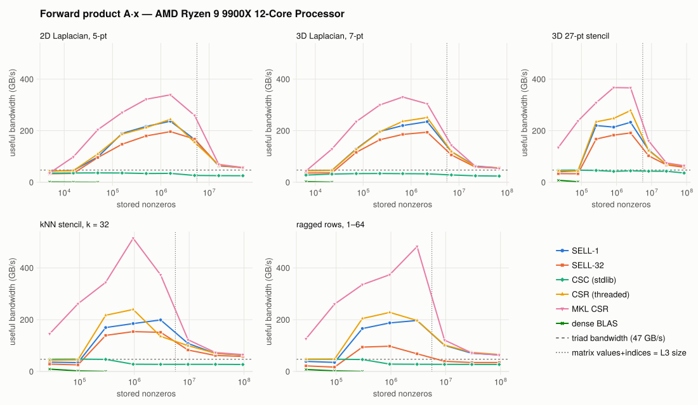
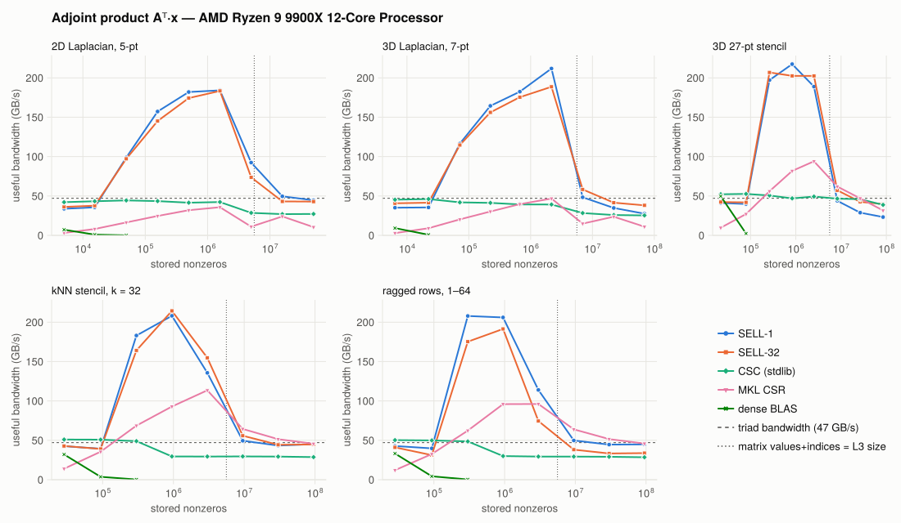
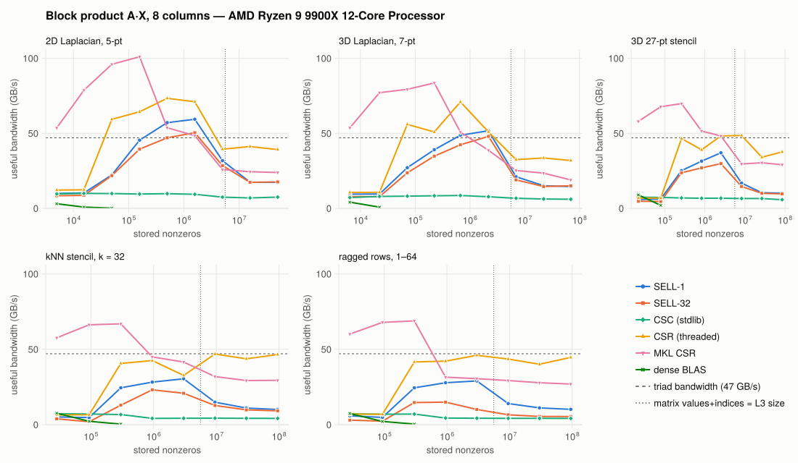
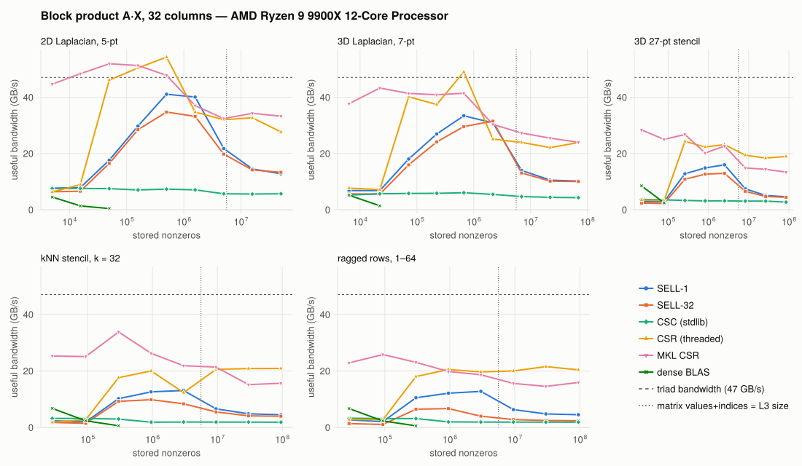
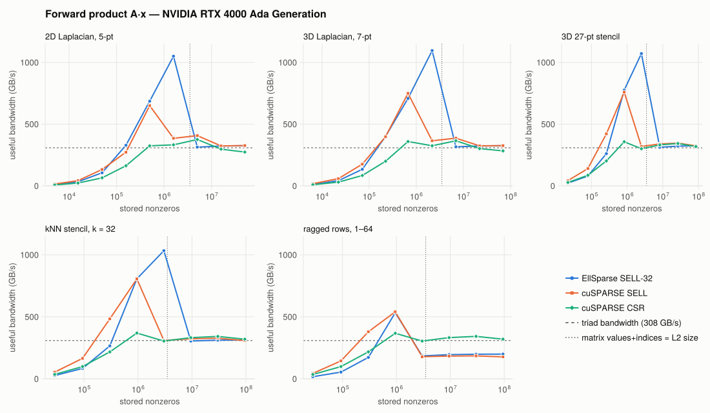
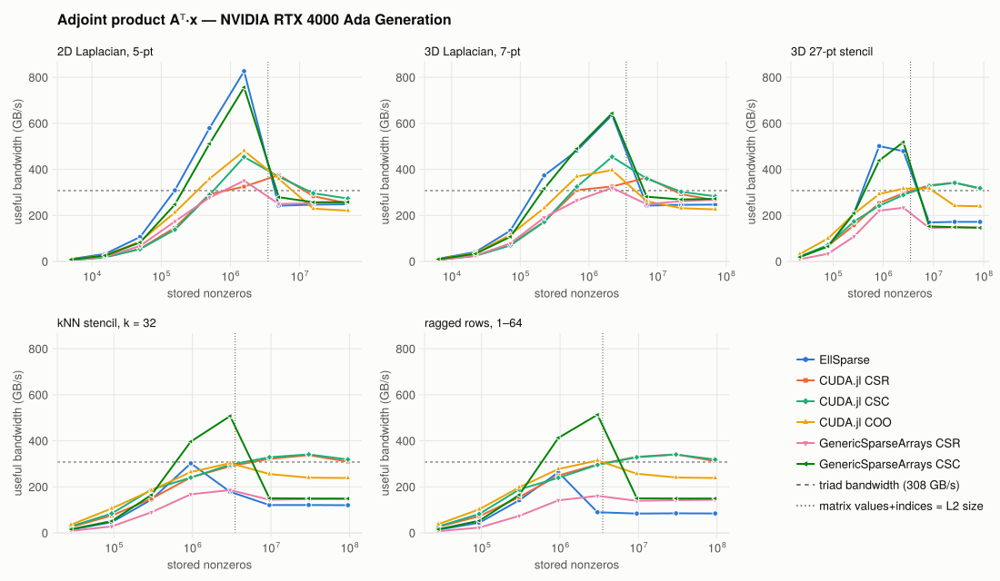
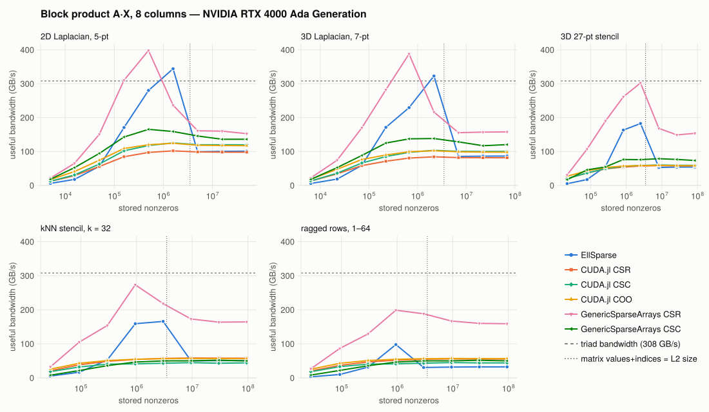
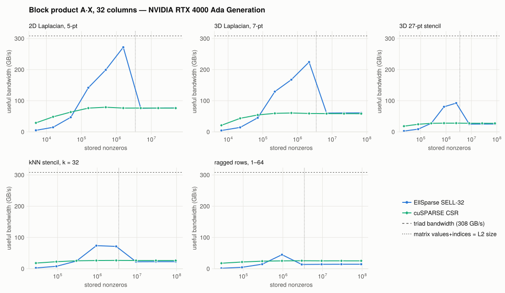

# Benchmarks

How SELL compares with the other sparse formats you might reach for, across matrix sizes from a thousand rows to ten million, on one CPU and one GPU. Three operations are measured: the forward product `A * x`, the adjoint `A' * x`, and a block product `A * X` with 8 or 32 right-hand sides. Solves are left out. `A \ b` on a `SellMatrix` converts to CSC and calls UMFPACK, so timing it would measure CSC, and an iterative solve's speed is its matvec's, diluted by the vector work around it.

## Reading the plots

Every panel plots **useful bandwidth** against matrix size. Useful bandwidth is the minimum number of bytes the product has to move, divided by the time it took. The byte count is the same for every format: 12 bytes per stored nonzero (a `Float64` value and an `Int32` index), plus `x` and `y` once per right-hand side. Padding, re-reading the matrix, and extra indirection don't add to the count. They show up as a lower line.

Bandwidth is the right axis because sparse products are almost pure streaming. Each stored entry is read once and used for one multiply-add, so the arithmetic is cheap and the memory system sets the speed. That gives every curve the same three regimes, the way a pipe-flow curve has laminar, transitional, and turbulent regions:

  - **Small matrices** (left): a fixed per-call cost, from thread spawns on the CPU and kernel launches on the GPU, dominates, and bandwidth rises with size.
  - **Cache-resident** (middle, left of the dotted line): the matrix fits in the last-level cache. Bandwidth can far exceed DRAM speed, and kernel quality matters most here.
  - **DRAM-bound** (right): the matrix streams from main memory, every good implementation converges toward the dashed triad line (measured STREAM-style bandwidth), and the layout decides who wins.

The dotted line marks where the matrix's values and indices alone equal the cache size. Formats with extra structure, such as EllSparse's transpose map or padding, leave cache somewhat earlier.

Methodology: every format uses `Int32` indices and `Float64` values. Each result is checked against a reference product before it is timed, and the reported time is the minimum over repeated runs. The tables list the largest size of each family.

## CPU

AMD Ryzen 9 9900X (12 cores, 12 Julia threads, 64 MB L3, measured triad 47 GB/s), Julia 1.13.3. The formats:

  - **SELL-1** and **SELL-32**: EllSparse at its CPU and GPU slice heights.
  - **CSC (stdlib)**: `SparseMatrixCSC`. Its forward product is single-threaded.
  - **CSR (threaded)**: a `Threads.@threads` row loop over [SparseMatricesCSR.jl](https://github.com/gridap/SparseMatricesCSR.jl) storage, the fair multithreaded rival.
  - **MKL CSR**: Intel MKL through [MKLSparse.jl](https://github.com/JuliaSparse/MKLSparse.jl). This is an AMD CPU, so MKL may not take its fastest code path.
  - **dense BLAS**: OpenBLAS on `Matrix(A)`, up to 10⁴ rows.

### Forward product



| Matrix (rows) | SELL-1 | SELL-32 | CSC (stdlib) | CSR (threaded) | MKL CSR |
|:--|--:|--:|--:|--:|--:|
| 2D Laplacian, 5-pt (10.0M) | 56.7 | 57.2 | 25.3 | 56.0 | 56.9 |
| 3D Laplacian, 7-pt (9.9M) | 55.1 | 56.4 | 24.0 | 55.3 | 53.6 |
| 3D 27-pt stencil (3.2M) | 62.1 | 58.0 | 35.8 | 63.1 | 64.2 |
| kNN stencil, k = 32 (3.2M) | 63.8 | 58.0 | 26.9 | 63.9 | 65.1 |
| ragged rows, 1–64 (3.2M) | 63.5 | 34.5 | 26.9 | 65.2 | 63.4 |

Useful GB/s. Once a matrix outgrows L3, SELL-1, threaded CSR, and MKL all stream at the same speed, 1.7–2.4× faster than the single-threaded stdlib CSC. That is the bandwidth ceiling at work: once memory is the bottleneck, any row-parallel layout without padding performs the same. SELL-1 can't be padded, because each of its slices is a single row. SELL-32 pads each slice of 32 rows to its longest row. On the ragged family nearly half of its storage is padding, and its bandwidth halves to match.

The cache-resident middle is where the formats differ. MKL's tuned kernel is 1.1–2× faster than SELL-1 there: 23 vs 35 μs on the 2D Laplacian at 10⁵ rows, and 11 vs 22 μs on kNN at 10⁴ rows. Below 4096 rows the gap grows to 4–8×, because EllSparse, like the CSR loop, switches to a serial loop there while MKL stays threaded. EllSparse's CPU kernel matches a plain threaded CSR loop, not a vendor library. Dense BLAS loses every forward product by 5–40×, even at 10³ rows.

### Adjoint product



| Matrix (rows) | SELL-1 | SELL-32 | CSC (stdlib) | MKL CSR |
|:--|--:|--:|--:|--:|
| 2D Laplacian, 5-pt (10.0M) | 44.6 | 42.9 | 27.2 | 10.5 |
| 3D Laplacian, 7-pt (9.9M) | 27.5 | 38.1 | 25.3 | 11.0 |
| 3D 27-pt stencil (3.2M) | 23.2 | 39.7 | 38.7 | 31.6 |
| kNN stencil, k = 32 (3.2M) | 45.1 | 44.7 | 28.7 | 45.6 |
| ragged rows, 1–64 (3.2M) | 44.8 | 33.7 | 28.5 | 45.9 |

For a row-major layout, `Aᵀx` is a scatter: each row adds into many outputs. CSC gets the adjoint as a gather for free, since its columns are the rows of `Aᵀ`, but the stdlib loop is serial. EllSparse turns the scatter into a threaded gather through its [`TransposeMap`](@ref). Inside cache that gather is 3–5× faster than CSC. Out of cache its indirection costs bandwidth: on the 3D families, SELL-1 falls to CSC speed or below, while SELL-32 holds up better. MKL's CSR adjoint is a true scatter. It is 2.5–4× slower than SELL on the Laplacians and matches it on kNN and ragged. No CPU format produced a non-repeatable adjoint in these runs (bitwise-identical over 20 repeats). The GPU is different.

The row-major formats need the scatter, so the threaded CSR loop has no adjoint line. A fair threaded version would need atomics or per-thread buffers.

### Block product





| Matrix (rows) | SELL-1 | SELL-32 | CSC (stdlib) | CSR (threaded) | MKL CSR |
|:--|--:|--:|--:|--:|--:|
| 2D Laplacian, 5-pt (10.0M) | 12.8 | 13.3 | 5.7 | 27.7 | 33.2 |
| 3D Laplacian, 7-pt (9.9M) | 10.2 | 10.0 | 4.3 | 23.9 | 24.0 |
| 3D 27-pt stencil (3.2M) | 4.6 | 4.4 | 2.7 | 18.9 | 13.4 |
| kNN stencil, k = 32 (3.2M) | 4.5 | 4.0 | 1.8 | 20.9 | 15.6 |
| ragged rows, 1–64 (3.2M) | 4.5 | 2.4 | 1.8 | 20.4 | 15.9 |

32 columns, useful GB/s. This is EllSparse's weakest result. Its CPU `mul!(Y, A, X)` applies one column at a time, so it streams the whole matrix from memory once per column. The threaded CSR loop applies each row to every column while that row is still in cache, so it streams the matrix once per block. The gap grows with nonzeros per row, from 2.2× on the 2D Laplacian to 4.6× on kNN, at both 8 and 32 columns. A row-blocked multi-column kernel would close it. It is the same change as the batched multi-column `mul!` listed under "Not yet supported". Dense BLAS is the one place where dense competes: at 10³ rows on the 27-point, kNN, and ragged families (2–3% fill), its GEMM beats every sparse format with 8 columns.

## GPU

NVIDIA RTX 4000 Ada Generation (40 MB L2, measured triad 308 GB/s), cuSPARSE 12.8.6, CUDA.jl 6.5.1. **EllSparse SELL-32** is EllSparse's own KernelAbstractions kernels. **cuSPARSE SELL** reads the same buffers through the handoff described on the [cuSPARSE](cusparse.md) page. **cuSPARSE CSR** is the usual baseline. SpMV uses a preallocated cuSPARSE workspace. The block product calls cuSPARSE CSR through CUDA.jl's own `mul!`, the path a user would take. cuSPARSE has no SELL block product.

### Forward product



| Matrix (rows) | EllSparse SELL-32 | cuSPARSE SELL | cuSPARSE CSR |
|:--|--:|--:|--:|
| 2D Laplacian, 5-pt (10.0M) | 325.6 | 326.5 | 273.6 |
| 3D Laplacian, 7-pt (9.9M) | 325.4 | 326.2 | 283.1 |
| 3D 27-pt stencil (3.2M) | 324.7 | 324.2 | 318.4 |
| kNN stencil, k = 32 (3.2M) | 312.8 | 308.2 | 319.3 |
| ragged rows, 1–64 (3.2M) | 199.1 | 176.9 | 319.8 |

On the uniform families, EllSparse and cuSPARSE SELL are within 2% of each other at every large size, because the layout sets the speed and the two share a layout. On the short-row Laplacians, SELL beats CSR by 15–19%. With only 5–7 entries per row, CSR's per-row bookkeeping and uneven warp work cost it, while a SELL slice is a fixed rectangle. On ragged rows, padding reverses the result, and CSR is 1.6–1.8× faster than either SELL. Below about 10⁵ nonzeros, every format runs at a flat 5–11 μs of launch overhead.

### Adjoint product



| Matrix (rows) | EllSparse SELL-32 | cuSPARSE SELL | cuSPARSE CSR |
|:--|--:|--:|--:|
| 2D Laplacian, 5-pt (10.0M) | 248.3 | 269.6† | 258.0† |
| 3D Laplacian, 7-pt (9.9M) | 247.2 | 281.0† | 271.2† |
| 3D 27-pt stencil (3.2M) | 171.9 | 321.7† | 316.8† |
| kNN stencil, k = 32 (3.2M) | 120.3 | 308.5† | 311.8† |
| ragged rows, 1–64 (3.2M) | 83.9 | 197.8† | 314.1† |

† Not bitwise-repeatable across 20 runs.

This figure shows the trade-off the [cuSPARSE](cusparse.md) page describes, now as a function of size. cuSPARSE scatters with atomic adds, which is fast but nondeterministic. EllSparse gathers through its transpose map, which is deterministic but costs one extra indirect read per entry. While the matrix and the map both fit in L2, those extra reads are nearly free, and EllSparse's gather beats cuSPARSE's atomics by up to 2.2× (842 vs 376 GB/s on the 2D Laplacian at 1.6M nonzeros). Once they spill out of L2, the indirect reads go to DRAM. EllSparse then runs at 0.9× cuSPARSE on the Laplacians, 0.5× on the 27-point stencil, and 0.3–0.4× on kNN and ragged rows. Only EllSparse's adjoint was repeatable on the GPU.

### Block product





| Matrix (rows) | EllSparse SELL-32 | cuSPARSE CSR |
|:--|--:|--:|
| 2D Laplacian, 5-pt (10.0M) | 76.8 | 76.3 |
| 3D Laplacian, 7-pt (9.9M) | 60.9 | 58.4 |
| 3D 27-pt stencil (3.2M) | 25.2 | 27.4 |
| kNN stencil, k = 32 (3.2M) | 22.6 | 26.3 |
| ragged rows, 1–64 (3.2M) | 14.4 | 25.2 |

32 columns, useful GB/s. EllSparse launches one kernel per column and synchronizes once at the end, so 32 columns cost 32 matvecs. cuSPARSE's CSR SpMM does barely better: on kNN, 32 columns take 28× its matvec time. EllSparse therefore stays within 15% of it on every family except ragged, where padding again costs about 1.7×. A kernel that reused each row across columns could beat both.

## Summary

  - **SELL-1 on CPU and SELL-32 on GPU match the best row-major formats once the matrix streams from memory**, because at that point the layout is all that matters. On the GPU, the short-row Laplacians favor SELL over CSR by 15–19%.
  - **Ragged rows are SELL-32's weak case.** When row lengths vary within a slice of 32, padding scales the cost directly. SELL-1 on CPU has no slices to pad, so it doesn't pay this.
  - **EllSparse's adjoint is the only one that was always repeatable, and it is fast while its transpose map fits in cache.** Past that point on the GPU, determinism costs 1.1–3.7× against cuSPARSE's atomic scatter.
  - **Multi-column products are the clearest gap.** On the CPU, a row-blocked kernel would be worth 2.2–4.6×.

## Reproducing

```sh
julia --project=benchmark --startup-file=no -e 'using Pkg; Pkg.instantiate()'   # once
julia -t 12 --project=benchmark --startup-file=no benchmark/sweep_cpu.jl
julia -t 12 --project=benchmark --startup-file=no benchmark/sweep_cpu.jl mkl
julia --project=benchmark --startup-file=no benchmark/sweep_gpu.jl             # CUDA only
julia --project=benchmark --startup-file=no benchmark/plot.jl                  # figures + tables
```

MKL runs in its own process because loading MKLSparse.jl reroutes `mul!` for every `SparseMatrixCSC`, which would silently turn the stdlib baseline into MKL. Raw timings are in `benchmark/results/*.csv`. Set `BENCH_SECONDS` to change the sampling budget per measurement (default 0.5 s).
