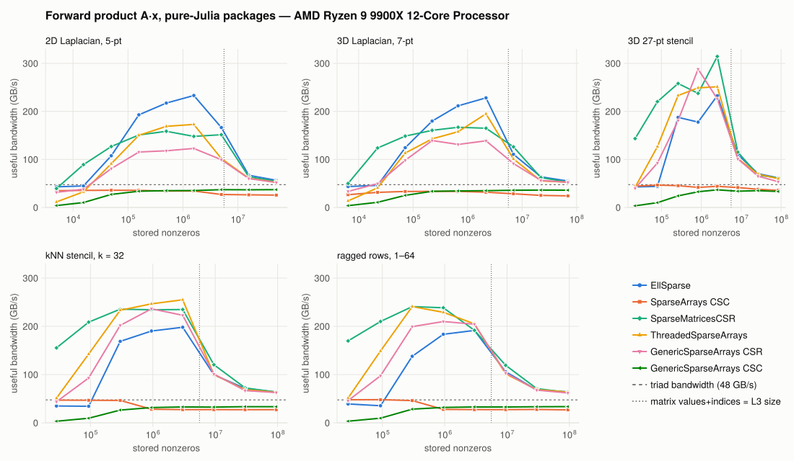
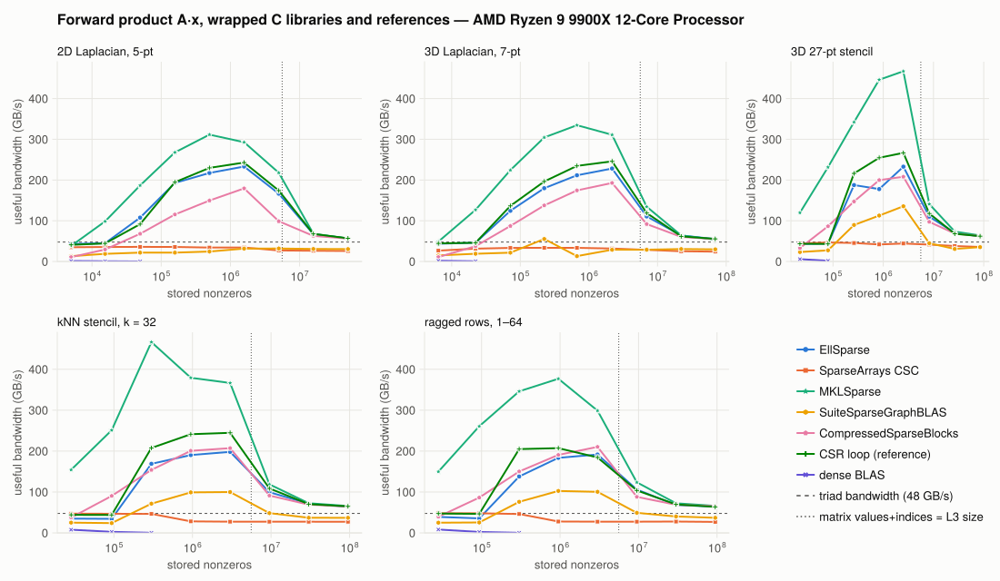
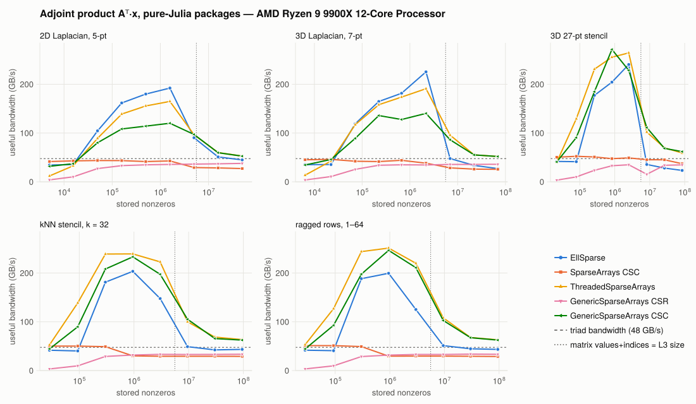
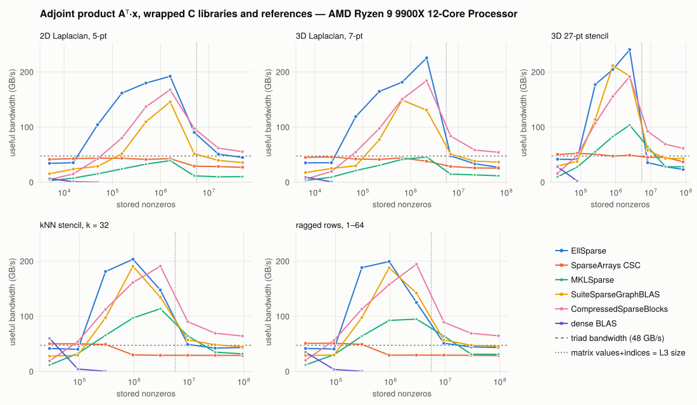
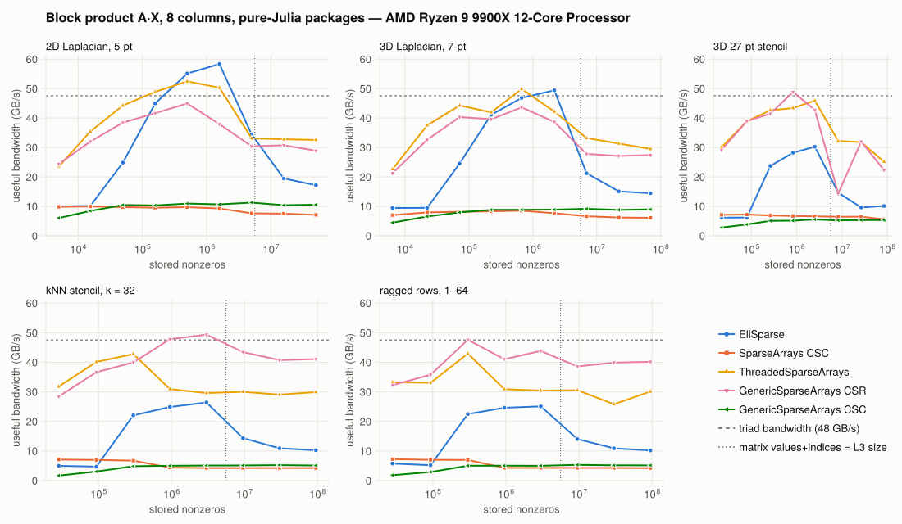
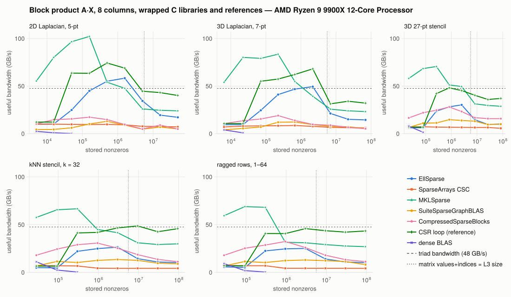
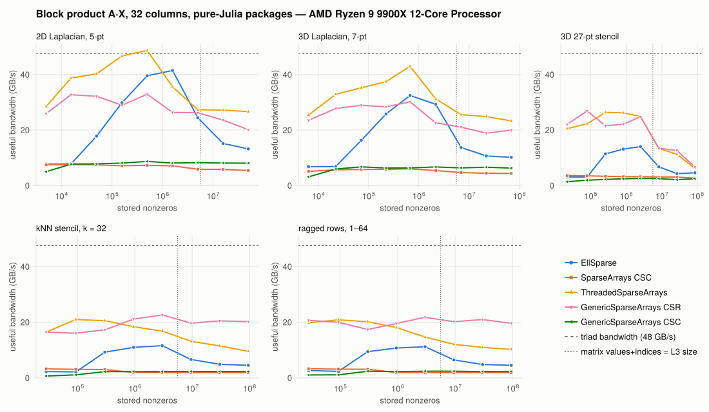
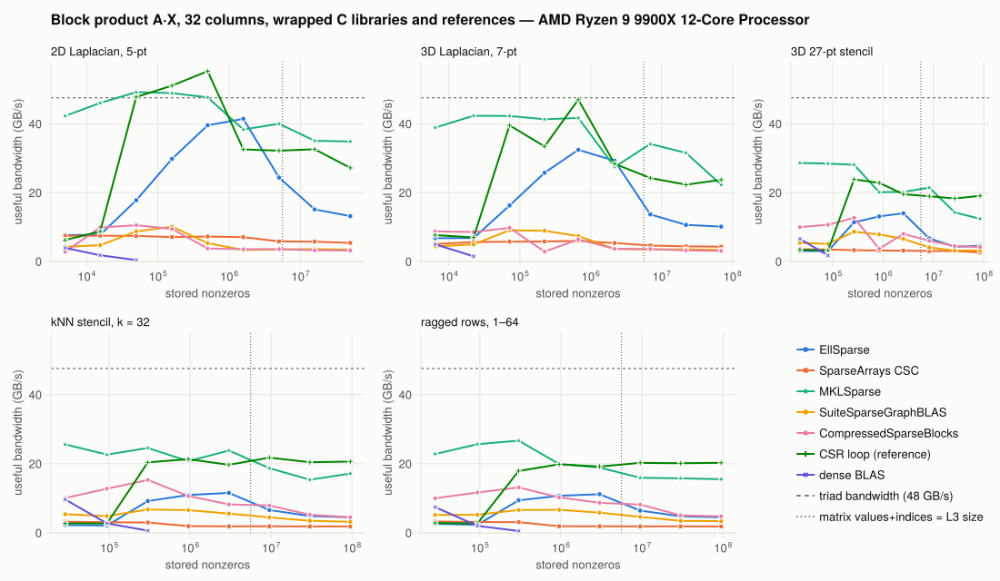

# Benchmarks

This page compares EllSparse with the sparse-matrix packages a Julia user can install today. The matrices range from a thousand rows to ten million, and everything runs on one CPU and one GPU. Three operations are measured: the forward product `A * x`, the adjoint `A' * x`, and a block product `A * X` with 8 or 32 right-hand sides. Solves are left out. `A \ b` on a `SellMatrix` converts to CSC and calls UMFPACK, so timing it would only measure CSC. An iterative solve's speed is its matvec's, diluted by the vector work around it.

## Reading the plots

Every panel plots **useful bandwidth** against matrix size. Useful bandwidth is the minimum number of bytes the product has to move, divided by the time it took. The byte count is the same for every format: 12 bytes per stored nonzero (a `Float64` value and a 4-byte index), plus `x` and `y` once per right-hand side. Padding, re-reading the matrix, and extra indirection don't add to the count, so they show up as a lower line.

Bandwidth is the right axis because sparse products are almost pure streaming. Each stored entry is read once and used for one multiply-add, so the arithmetic is cheap and memory sets the speed. That gives every curve the same three regimes, much as a pipe-flow curve has laminar, transitional, and turbulent regions:

  - **Small matrices** (left): a fixed cost per call dominates, from thread spawns on the CPU and kernel launches on the GPU, so bandwidth rises with size.
  - **Cache-resident** (middle, left of the dotted line): the matrix fits in the last-level cache. Bandwidth can far exceed DRAM speed, and this is where kernel quality matters most.
  - **DRAM-bound** (right): the matrix streams from main memory, and every good implementation converges toward the dashed triad line (a measured, STREAM-style bandwidth). Here the storage layout decides who wins.

The dotted line marks where the matrix's values and indices alone equal the cache size. Formats with extra structure, such as EllSparse's transpose map or padding, leave cache somewhat earlier.

Methodology:

  - Every format stores `Float64` values and 4-byte indices: `Int32`, or `UInt32` for CompressedSparseBlocks, which accepts nothing else.
  - Each package is called the way its own documentation shows, through plain `mul!`.
  - Each result is checked against a reference product before it is timed. The reported time is the minimum over repeated runs.
  - If a package has no specialized method for an operation, that operation is left out. Timing it through LinearAlgebra's generic dense fallback would cost O(m·n) and would not finish at these sizes.
  - The tables list the largest size of each family, in useful GB/s.

## The field

CPU, both figures:

  - **EllSparse**: `sell(S)`, the CPU layout. Each slice holds one row, so there is no padding.
  - **SparseArrays CSC**: the stdlib `SparseMatrixCSC`. Its forward product is single-threaded.

CPU, pure-Julia packages:

  - [**SparseMatricesCSR.jl**](https://github.com/gridap/SparseMatricesCSR.jl) 0.6.12: `SparseMatrixCSR`. Its forward product is threaded with Polyester. It has no adjoint or block-product method.
  - [**ThreadedSparseArrays.jl**](https://github.com/jagot/ThreadedSparseArrays.jl) 0.2.3: `ThreadedSparseMatrixCSC`, which threads `A'x`, and threads `A*X` over columns. A plain `A*x` is not threaded, so the forward product follows the README's advice: store `Sᵀ` and apply its adjoint. That keeps a second copy of the matrix.
  - [**GenericSparseArrays.jl**](https://github.com/albertomercurio/GenericSparseArrays.jl) 0.1.2: `GenericSparseMatrixCSR` and `GenericSparseMatrixCSC`, running KernelAbstractions kernels on the CPU backend. Its `mul!` doesn't synchronize, so each timed call ends with a synchronize.

CPU, wrapped C libraries and references:

  - [**MKLSparse.jl**](https://github.com/JuliaSparse/MKLSparse.jl) 3.0.0: Intel MKL, applied to `transpose(sparse(transpose(S)))`. That is CSR storage, MKL's fast orientation. Loading MKLSparse reroutes `mul!` for every `SparseMatrixCSC`, so it runs in its own process. This is an AMD CPU, so MKL may not take its fastest code path.
  - [**SuiteSparseGraphBLAS.jl**](https://github.com/JuliaSparse/SuiteSparseGraphBLAS.jl) 0.12.0: `GBMatrix`, multithreaded with OpenMP. Its dense `mul!` packs `x`, multiplies, and copies the result out.
  - [**CompressedSparseBlocks.jl**](https://github.com/fcdimitr/CompressedSparseBlocks.jl) 0.1.1: `SparseMatrixCSB`, a C/Cilk library built for fast `A*x` and `Aᵀx` from one structure. It runs on Linux and Intel macOS only, supports `Float64` only, and handles blocks of up to 32 columns.
  - **CSR loop (reference)**: a hand-written `Threads.@threads` row loop over SparseMatricesCSR storage. It isn't a package. It shows what a straightforward threaded loop achieves, including a block product that applies each row to every column at once.
  - **dense BLAS**: OpenBLAS on `Matrix(A)`, up to 10⁴ rows.

GPU, all on CUDA.jl 6.4.2 (cuSPARSE 12.8.6) arrays:

  - **EllSparse**: `adapt(CuArray, sell(S; slice_height = 32))`, the GPU layout.
  - **CUDA.jl CSR, CSC, COO**: `CuSparseMatrixCSR`, `CuSparseMatrixCSC`, and `CuSparseMatrixCOO`. CUDA.jl manages the cuSPARSE descriptors and workspaces.
  - **GenericSparseArrays CSR and CSC**: the same types as on the CPU, adapted to `CuArray`.

Not included: ParallelMergeCSR.jl and ThreadedSparseCSR.jl don't compile on Julia 1.13, and HPCSparseArrays.jl is MPI-distributed, which is a different problem.

## CPU

AMD Ryzen 9 9900X (12 cores, 12 Julia threads, 64 MB L3, measured triad 48 GB/s), Julia 1.13.3.

### Forward product





| Matrix (rows) | EllSparse | SparseArrays CSC | SparseMatricesCSR | ThreadedSparseArrays | GenericSparseArrays CSR | GenericSparseArrays CSC |
|:--|--:|--:|--:|--:|--:|--:|
| 2D Laplacian, 5-pt (10.0M) | 56.5 | 25.7 | 54.2 | 52.3 | 52.0 | 37.1 |
| 3D Laplacian, 7-pt (9.9M) | 54.9 | 24.1 | 52.6 | 52.6 | 52.4 | 36.0 |
| 3D 27-pt stencil (3.2M) | 61.5 | 35.6 | 61.5 | 59.9 | 53.7 | 33.2 |
| kNN stencil, k = 32 (3.2M) | 63.9 | 27.2 | 63.4 | 63.2 | 62.7 | 33.4 |
| ragged rows, 1–64 (3.2M) | 64.3 | 26.9 | 63.0 | 63.6 | 61.9 | 33.6 |

| Matrix (rows) | EllSparse | MKLSparse | SuiteSparseGraphBLAS | CompressedSparseBlocks | CSR loop (reference) |
|:--|--:|--:|--:|--:|--:|
| 2D Laplacian, 5-pt (10.0M) | 56.5 | 56.2 | 30.3 | 56.1 | 56.8 |
| 3D Laplacian, 7-pt (9.9M) | 54.9 | 53.5 | 29.7 | 54.9 | 55.4 |
| 3D 27-pt stencil (3.2M) | 61.5 | 63.6 | 35.2 | 62.0 | 62.1 |
| kNN stencil, k = 32 (3.2M) | 63.9 | 65.8 | 36.9 | 64.3 | 64.9 |
| ragged rows, 1–64 (3.2M) | 64.3 | 66.1 | 36.9 | 65.3 | 63.5 |

Out of cache, every threaded row-oriented format lands at 52–66 GB/s. EllSparse ties SparseMatricesCSR, ThreadedSparseArrays, GenericSparseArrays CSR, MKL, and CSB. That's the bandwidth ceiling at work: once memory is the bottleneck, any layout that reads each entry once performs about the same. Three formats sit well below it:

  - **Stdlib CSC** (25–36 GB/s) is single-threaded.
  - **GenericSparseArrays CSC** (33–37 GB/s) does the forward product as an atomic scatter.
  - **GraphBLAS** (30–37 GB/s) pays for packing `x` and copying the result on every call.

The other two regimes are where the formats separate:

  - **In cache**, MKL leads EllSparse by 1.3–2× on every family. EllSparse beats the pure-Julia packages by 1.1–1.35× on the Laplacians: 233 vs 173 GB/s at 1.6M nonzeros on the 2D Laplacian. On the 27-point, kNN, and ragged families it trails them by up to 40%.
  - **Below 4096 rows**, EllSparse loses by up to 6.1× (34.2 vs 5.6 μs on kNN at 3,162 rows). EllSparse switches to a serial loop there, to avoid the tens-of-μs cost of spawning `@threads` tasks. SparseMatricesCSR stays threaded with Polyester, whose spawn cost is far lower. EllSparse's cutoff is set too conservatively for this machine ([#7](https://github.com/kylebeggs/EllSparse.jl/issues/7)).

### Adjoint product





| Matrix (rows) | EllSparse | SparseArrays CSC | ThreadedSparseArrays | GenericSparseArrays CSR | GenericSparseArrays CSC |
|:--|--:|--:|--:|--:|--:|
| 2D Laplacian, 5-pt (10.0M) | 44.9 | 27.1 | 52.7 | 37.8† | 52.6 |
| 3D Laplacian, 7-pt (9.9M) | 27.1 | 25.6 | 51.9 | 36.0† | 51.9 |
| 3D 27-pt stencil (3.2M) | 23.3 | 37.1 | 59.1 | 34.7† | 61.9 |
| kNN stencil, k = 32 (3.2M) | 43.4 | 29.1 | 63.4 | 33.4† | 62.4 |
| ragged rows, 1–64 (3.2M) | 43.4 | 28.8 | 62.9 | 33.3† | 62.4 |

| Matrix (rows) | EllSparse | MKLSparse | SuiteSparseGraphBLAS | CompressedSparseBlocks |
|:--|--:|--:|--:|--:|
| 2D Laplacian, 5-pt (10.0M) | 44.9 | 10.1 | 35.7 | 55.4 |
| 3D Laplacian, 7-pt (9.9M) | 27.1 | 11.7 | 36.6 | 54.3 |
| 3D 27-pt stencil (3.2M) | 23.3 | 28.2 | 43.0 | 61.4 |
| kNN stencil, k = 32 (3.2M) | 43.4 | 31.9 | 44.9 | 64.2 |
| ragged rows, 1–64 (3.2M) | 43.4 | 31.1 | 45.6 | 64.7 |

† Not bitwise-repeatable across 20 runs, at some size in the sweep. Every other CPU adjoint was repeatable.

For a row-oriented format, `Aᵀx` is a scatter: each row adds into many outputs. A column-oriented format gets the adjoint as a gather for free, because its columns are the rows of `Aᵀ`. That's why the threaded CSC gathers (ThreadedSparseArrays, GenericSparseArrays CSC) and CSB, which was designed for both directions, reach the bandwidth ceiling out of cache.

EllSparse also gathers, through its [`TransposeMap`](@ref), but every entry costs an extra indirect read: first a storage position from the map, then the value at that position. Out of cache, that indirection makes EllSparse 1.2–2.7× slower than the direct gathers. In cache the extra reads are nearly free. There EllSparse leads on the Laplacians and trails the best gather by 9–21% on the other families.

EllSparse's adjoint is repeatable, but on the CPU so is every adjoint here except GenericSparseArrays CSR's atomic scatter. So determinism isn't what sets EllSparse apart on the CPU. What does is fast products in both directions from one row-major structure. ThreadedSparseArrays only gets a fast forward product by storing the matrix twice, and the CSC formats' own forward products are scatters.

CompressedSparseBlocks is the one format that does better than EllSparse at large sizes, at 54–65 GB/s in both directions. But it's a C/Cilk library that only runs on CPUs, only with `Float64`, and only on Linux and Intel macOS.

### Block product









| Matrix (rows) | EllSparse | SparseArrays CSC | ThreadedSparseArrays | GenericSparseArrays CSR | GenericSparseArrays CSC |
|:--|--:|--:|--:|--:|--:|
| 2D Laplacian, 5-pt (10.0M) | 13.2 | 5.4 | 26.6 | 20.1 | 8.0 |
| 3D Laplacian, 7-pt (9.9M) | 10.1 | 4.3 | 23.2 | 20.0 | 6.2 |
| 3D 27-pt stencil (3.2M) | 4.5 | 2.6 | 6.2 | 6.6 | 2.4 |
| kNN stencil, k = 32 (3.2M) | 4.5 | 1.9 | 9.5 | 20.2 | 2.3 |
| ragged rows, 1–64 (3.2M) | 4.5 | 1.9 | 10.2 | 19.6 | 2.3 |

| Matrix (rows) | EllSparse | MKLSparse | SuiteSparseGraphBLAS | CompressedSparseBlocks | CSR loop (reference) |
|:--|--:|--:|--:|--:|--:|
| 2D Laplacian, 5-pt (10.0M) | 13.2 | 34.9 | 3.4 | 3.2 | 27.2 |
| 3D Laplacian, 7-pt (9.9M) | 10.1 | 22.3 | 3.3 | 3.1 | 23.7 |
| 3D 27-pt stencil (3.2M) | 4.5 | 12.4 | 3.2 | 4.2 | 19.1 |
| kNN stencil, k = 32 (3.2M) | 4.5 | 17.2 | 3.2 | 4.5 | 20.6 |
| ragged rows, 1–64 (3.2M) | 4.5 | 15.5 | 3.4 | 4.8 | 20.3 |

The tables show 32 columns. The block product is EllSparse's weakest result. Its CPU `mul!(Y, A, X)` applies one column at a time, so it streams the whole matrix from memory once per column. The fast formats read the matrix fewer times. The CSR loop and MKL apply each row to every column while that row is still in cache, and GenericSparseArrays CSR runs one work item per (row, column) pair.

Against the best of these, EllSparse is 2.3–4.6× slower at both 8 and 32 columns. Below 4096 rows the gap reaches 14× against MKL, because EllSparse's serial cutoff applies to each column. A row-blocked multi-column kernel would close most of this gap. That kernel is the batched multi-column `mul!` listed under "Not yet supported" ([#8](https://github.com/kylebeggs/EllSparse.jl/issues/8)).

## GPU

NVIDIA RTX 4000 Ada Generation (40 MB L2, measured triad 308 GB/s), CUDA.jl 6.4.2, cuSPARSE 12.8.6.

### Forward product


| Matrix (rows) | EllSparse | CUDA.jl CSR | CUDA.jl CSC | CUDA.jl COO | GenericSparseArrays CSR | GenericSparseArrays CSC |
|:--|--:|--:|--:|--:|--:|--:|
| 2D Laplacian, 5-pt (10.0M) | 325.7 | 272.9 | 252.8 | 236.7 | 257.9 | 256.8 |
| 3D Laplacian, 7-pt (9.9M) | 325.5 | 282.4 | 265.4 | 237.2 | 271.7 | 268.1 |
| 3D 27-pt stencil (3.2M) | 324.5 | 317.4 | 314.7 | 242.4 | 146.9 | 147.8 |
| kNN stencil, k = 32 (3.2M) | 312.3 | 319.3 | 310.6 | 242.6 | 152.0 | 151.9 |
| ragged rows, 1–64 (3.2M) | 199.2 | 319.8 | 310.4 | 242.6 | 143.4 | 151.8 |

The forward product is EllSparse's strongest result:

  - **Short rows:** it leads on the Laplacians by 15–19% over the best alternative.
  - **Long rows:** it ties on the 27-point and kNN families.
  - **Inside L2:** it leads on every family, by 1.15–2.3× (1,150 vs 505 GB/s on kNN at 3M nonzeros).
  - **Small matrices:** its launch overhead is the lowest, about 7.5 μs against 9–14 μs for the others.

The reason is the slot-major SELL-32 layout. The 32 threads of a warp each own one row, and at every step they read 32 adjacent words. A slice is a fixed rectangle, so no per-row bookkeeping is needed. CSR has to look up each row's extent and gives threads in a warp unequal work, which costs most when rows are short. GenericSparseArrays assigns one thread per row over CSR storage, so a warp's reads hit 32 different cache lines. It drops to half the bandwidth on the long-row families.

Ragged rows are the exception. SELL-32 pads each slice of 32 rows to its longest row. When row lengths vary from 1 to 64, nearly half the stored entries are padding, and CUDA.jl CSR is 1.6× faster.

### Adjoint product


| Matrix (rows) | EllSparse | CUDA.jl CSR | CUDA.jl CSC | CUDA.jl COO | GenericSparseArrays CSR | GenericSparseArrays CSC |
|:--|--:|--:|--:|--:|--:|--:|
| 2D Laplacian, 5-pt (10.0M) | 248.3 | 252.6† | 273.2 | 220.8† | 256.8† | 257.9 |
| 3D Laplacian, 7-pt (9.9M) | 247.1 | 266.1† | 282.9 | 226.1† | 268.6† | 272.0 |
| 3D 27-pt stencil (3.2M) | 171.8 | 315.8† | 318.5 | 239.7† | 148.1† | 146.3 |
| kNN stencil, k = 32 (3.2M) | 120.3 | 309.3† | 318.9 | 238.3† | 147.9† | 148.8 |
| ragged rows, 1–64 (3.2M) | 84.4 | 311.4† | 318.6 | 238.5† | 143.7† | 149.5 |

† Not bitwise-repeatable across 20 runs, at some size in the sweep.

On the GPU, determinism splits the field in two:

  - **Row-oriented formats** (CSR, COO, GenericSparseArrays CSR) scatter with atomic adds. That's fast, but the order of the additions depends on thread scheduling, so the last bits change from run to run.
  - **Column-oriented formats** gather, and their adjoints are repeatable. CUDA.jl CSC is the fastest repeatable adjoint at scale, at 273–319 GB/s.

EllSparse's adjoint is repeatable, and fast while its transpose map fits in L2. There it leads or ties on the stencil families and trails GenericSparseArrays CSC on kNN and ragged rows. Out of L2, the extra indirect read per entry goes to DRAM, which makes EllSparse 1.1–3.8× slower than CUDA.jl CSC.

So on the GPU, the choice comes down to which direction matters more:

  - **CUDA.jl CSC** gives the best repeatable adjoint. Its forward product, a transposed-CSR operation inside cuSPARSE, is fast too, at 253–315 GB/s. This sweep only recorded repeatability for adjoints, so whether CSC's forward product is repeatable wasn't measured.
  - **EllSparse** gives the best forward product, plus a repeatable adjoint that holds up until the matrix outgrows L2.

### Block product


| Matrix (rows) | EllSparse | CUDA.jl CSR | CUDA.jl CSC | CUDA.jl COO | GenericSparseArrays CSR | GenericSparseArrays CSC |
|:--|--:|--:|--:|--:|--:|--:|
| 2D Laplacian, 5-pt (10.0M) | 101.0 | 98.0 | 119.8 | 117.1 | 152.6 | 136.1 |
| 3D Laplacian, 7-pt (9.9M) | 86.6 | 81.5 | 100.2 | 98.0 | 157.8 | 120.4 |
| 3D 27-pt stencil (3.2M) | 54.2 | 57.7 | 59.2 | 58.1 | 153.7 | 73.5 |
| kNN stencil, k = 32 (3.2M) | 50.8 | 57.7 | 44.1 | 56.5 | 164.3 | 49.8 |
| ragged rows, 1–64 (3.2M) | 32.3 | 55.4 | 43.9 | 56.5 | 159.0 | 49.9 |

The table shows 8 columns. At this width, GenericSparseArrays CSR wins at every large size, 1.5–4.9× ahead of EllSparse. It launches one kernel over every (row, column) pair, so the rows a block needs are read close together in time and mostly come from L2. EllSparse launches one kernel per column, so it reads the matrix once per column. That keeps it within about 20% of CUDA.jl's formats, except on ragged rows.

At 32 columns, CUDA.jl CSC and COO lead on the Laplacians, with EllSparse 16–18% behind. GenericSparseArrays CSR leads on the long-row families, 1.6–2.7× ahead of EllSparse. In L2 the picture flips: on the Laplacians at 32 columns, EllSparse leads every format, at 268 vs 94 GB/s.

## Summary

  - **Forward product:** EllSparse matches the best options on the CPU at scale and leads on the GPU. Out of cache on the CPU, it ties the threaded row formats and MKL. On the GPU it is 15–19% ahead on short rows, ahead of every format inside L2, and tied otherwise. The exception is ragged rows on the GPU, where SELL-32 padding makes it 1.6× slower than CSR.
  - **Small CPU matrices:** this loss is fixable. Below 4096 rows, EllSparse's serial cutoff makes it up to 6.1× slower than SparseMatricesCSR ([#7](https://github.com/kylebeggs/EllSparse.jl/issues/7)).
  - **Adjoint:** EllSparse is fast in cache but slower than plain CSC gathers out of cache, by 1.2–2.7× on the CPU and 1.1–3.8× on the GPU, because of the transpose map's extra indirect read. Its real advantage is fast forward products and repeatable adjoints from one structure, not adjoint speed alone. CompressedSparseBlocks does both directions faster on the CPU, within its platform limits.
  - **Repeatability:** it matters on the GPU, not on the CPU. Every CPU adjoint here but one was repeatable. On the GPU, only the gather-based formats were: EllSparse, CUDA.jl CSC, and GenericSparseArrays CSC.
  - **Block products:** these are the clearest gap. Because EllSparse applies one column at a time, it is 2.3–4.6× slower than the best CPU option, and 1.5–4.9× slower than GenericSparseArrays CSR on the GPU at 8 columns.

## Reproducing

```sh
julia --project=benchmark --startup-file=no -e 'using Pkg; Pkg.instantiate()'   # once
julia -t 12 --project=benchmark --startup-file=no benchmark/sweep_cpu.jl       # ~35 min
julia -t 12 --project=benchmark --startup-file=no benchmark/sweep_cpu.jl mkl   # ~5 min
julia --project=benchmark --startup-file=no benchmark/sweep_gpu.jl             # ~25 min, CUDA only
julia --project=benchmark --startup-file=no benchmark/plot.jl                  # figures + tables
```

Raw timings are in `benchmark/results/*.csv`. Set `BENCH_SECONDS` to change the sampling budget per measurement (default 0.5 s).
